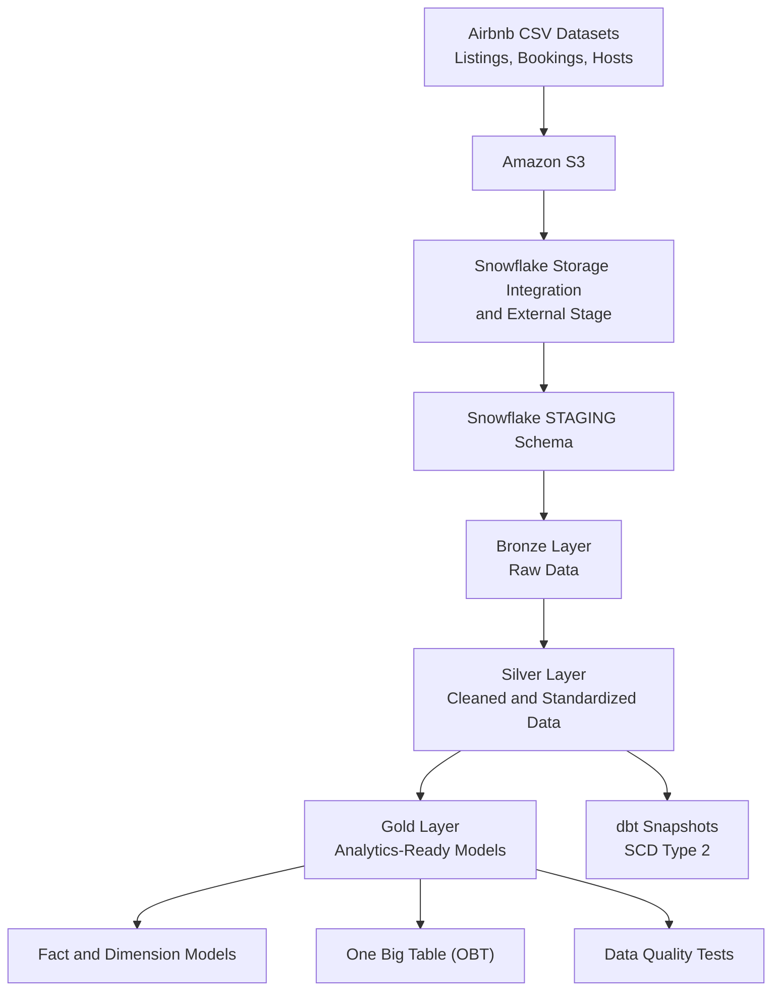

# Airbnb End-to-End Data Engineering Pipeline

Building an end-to-end ELT pipeline using **AWS S3, Snowflake, and dbt Core** to transform raw Airbnb datasets into structured, analytics-ready data using a Medallion Architecture.


## Overview

This project implements a cloud-based data engineering pipeline for Airbnb listings, bookings, and hosts data.

Raw datasets are stored in Amazon S3 and loaded into Snowflake staging tables. dbt is then used to transform the data through Bronze, Silver, and Gold layers, apply reusable SQL logic, maintain historical records, and produce analytics-ready data models.

The project demonstrates key data engineering concepts, including incremental data processing, metadata-driven loading, dimensional modeling, Slowly Changing Dimensions (SCD Type 2), and data quality testing.

## Architecture



### Data flow

1. **Data ingestion:** Store Airbnb source datasets in AWS S3 and make them accessible to Snowflake using the appropriate storage integration and staging configuration.
2. **Staging:** Load the source data into Snowflake staging tables for bookings, hosts, and listings.
3. **Transformation:** Use dbt models to process the data through the Bronze, Silver, and Gold layers.
4. **Data modeling:** Build analytical models, including a fact model, snapshot-based historical dimensions, and a One Big Table (OBT).
5. **Validation:** Run dbt tests to check source data and flag potential data quality issues.

## Data Transformation Layers

| Layer | Purpose |
|---|---|
| **Staging** | Makes source datasets available in Snowflake for dbt transformations. |
| **Bronze** | Retains the raw or minimally transformed representation of source data. |
| **Silver** | Cleans, standardizes, and transforms data for downstream use, including incremental processing where configured. |
| **Gold** | Provides business-oriented models for analytical queries and dimensional modeling. |

## Key Features

### 1. Medallion Architecture
Organizes data transformations into separate layers, making the pipeline easier to understand, maintain, and extend.

### 2. Incremental Data Processing
Uses dbt incremental model logic to process new or changed records according to the model's configured loading rules, rather than rebuilding every dataset from scratch on every run.

### 3. Metadata-Driven Processing
Demonstrates configurable data loading logic to make the pipeline more adaptable to different datasets and processing requirements.

### 4. Reusable SQL with Jinja and Custom Macros
Uses dbt macros and Jinja templating to reuse transformation logic, reduce repeated SQL, and make model definitions more maintainable.

### 5. Dimensional Data Modeling
Creates analytical data models, including a fact model and a One Big Table (OBT), to support different patterns of data consumption.

### 6. Historical Tracking with SCD Type 2
Implements timestamp-based dbt snapshots for bookings, hosts, and listings to preserve historical versions when tracked records change.

### 7. Data Quality Testing
Includes dbt source definitions and a custom SQL test in `tests/source_test.sql` to identify potential data quality issues.

### 8. Modular and Maintainable dbt Project
Separates models, macros, snapshots, analyses, source definitions, and tests into dedicated directories. dbt also provides model dependency information and documentation-generation capabilities.

## Data Modeling

### Fact Model
The Gold layer contains a fact model designed to represent analytical data at the grain defined by the model.

### Snapshot-Based Dimensions
The snapshot configurations track historical versions of booking, host, and listing records using configured unique keys and timestamp columns.

### One Big Table (OBT)
The OBT combines related datasets into a denormalized structure, making it easier to query multiple aspects of Airbnb data together.

These approaches demonstrate the trade-offs between normalized dimensional models and denormalized analytical tables.

## Technology Stack

| Technology | Role |
|---|---|
| **Amazon S3** | Cloud object storage for source datasets |
| **Snowflake** | Cloud data warehouse and SQL execution engine |
| **dbt Core** | SQL transformation orchestration and model management |
| **dbt-snowflake** | Adapter connecting dbt to Snowflake |
| **SQL** | Data transformation and validation |
| **Jinja** | Dynamic SQL and reusable macros |
| **Python** | Development environment and tooling |
| **uv** | Python package and environment management |
| **Git & GitHub** | Version control and project documentation |

## Project Structure

The main transformation project is located in `aws_dbt_snowflake_project/`.

```text
Airbnb-Snowflake-DBT-Data-Engineering/
│
├── aws_dbt_snowflake_project/
│   ├── models/
│   │   ├── sources/
│   │   │   └── sources.yml
│   │   ├── bronze/
│   │   ├── silver/
│   │   └── gold/
│   │       └── ephemeral/
│   │
│   ├── macros/
│   ├── snapshots/
│   ├── tests/
│   ├── analyses/
│   ├── dbt_project.yml
│   └── .gitignore
│
├── .gitignore
├── .python-version
├── pyproject.toml
├── uv.lock
└── README.md
```

*The directories above highlight the main dbt components; refer to the repository for the complete set of model and configuration files.*

## Getting Started

### Prerequisites

Before running the pipeline, you need:

- Python and `uv` installed.
- A Snowflake account with the required database, schemas, warehouse, and permissions.
- An AWS S3 bucket containing the source datasets.
- The required AWS IAM permissions, Snowflake storage integration, external stage, and staging tables.
- A configured dbt profile for Snowflake.

**Setup note:** The dbt project references the source tables `AIRBNB.STAGING.BOOKINGS`, `AIRBNB.STAGING.HOSTS`, and `AIRBNB.STAGING.LISTINGS`. The necessary AWS/Snowflake infrastructure and source data must be prepared before running the transformations.

### 1. Clone the Repository

```powershell
git clone https://github.com/MMAR4/Airbnb-Snowflake-DBT-Data-Engineering.git
cd Airbnb-Snowflake-DBT-Data-Engineering
```

### 2. Create the Python Environment

```powershell
uv venv .venv
.\.venv\Scripts\Activate.ps1
uv pip install dbt-snowflake
```

Verify the installation:

```powershell
dbt --version
```

### 3. Configure Your Snowflake Connection

Create your local dbt profiles directory and file:

```powershell
New-Item -ItemType Directory -Force "$HOME\.dbt"
notepad "$HOME\.dbt\profiles.yml"
```

Use the following as a template:

```yaml
aws_dbt_snowflake_project:
  target: dev
  outputs:
    dev:
      type: snowflake
      account: "<YOUR_SNOWFLAKE_ACCOUNT>"
      user: "<YOUR_SNOWFLAKE_USER>"
      password: "{{ env_var('DBT_ENV_SECRET_SNOWFLAKE_PASSWORD') }}"
      role: "<YOUR_SNOWFLAKE_ROLE>"
      warehouse: "<YOUR_SNOWFLAKE_WAREHOUSE>"
      database: AIRBNB
      schema: STAGING
      threads: 4
```

Set `DBT_ENV_SECRET_SNOWFLAKE_PASSWORD` in your local environment before running dbt. Replace the other placeholders with your own Snowflake connection details.

**Never commit credentials or your local `profiles.yml` to GitHub.**

### 4. Run the dbt Project

Navigate to the dbt project directory:

```powershell
cd aws_dbt_snowflake_project
```

Check the connection:

```powershell
dbt debug
```

Parse the project:

```powershell
dbt parse
```

Run the models:

```powershell
dbt run
```

Run data quality tests:

```powershell
dbt test
```

Execute snapshots:

```powershell
dbt snapshot
```

Build the selected dbt resources and their dependencies:

```powershell
dbt build
```

### 5. Generate dbt Documentation

```powershell
dbt docs generate
dbt docs serve
```

Open the local address shown in the terminal to explore generated model documentation and lineage.

## Data Quality and Validation

The project uses dbt's testing capabilities to help identify data quality issues during transformation.

The custom SQL test at `tests/source_test.sql` flags source booking records with `BOOKING_AMOUNT` below the configured threshold. Its severity is set to `warn`, so matching records produce a warning rather than a test failure.

The pipeline can be validated by running the models, tests, and snapshots against a correctly configured Snowflake environment.

## Security

- Keep Snowflake credentials and local profiles outside version control.
- Do not commit AWS access keys, secret keys, or other sensitive information.
- Grant only the AWS and Snowflake permissions required by the pipeline.
- Use the repository's `.gitignore` to exclude local configuration and generated dbt artifacts.

## Potential Future Enhancements

- Add automated dbt validation through a CI workflow.
- Document repeatable AWS and Snowflake resource provisioning.
- Add a dashboard using the Gold-layer analytical models.
- Introduce scheduled orchestration for recurring pipeline execution.

## Author

**MMAR4**

- GitHub: [MMAR4](https://github.com/MMAR4)
- LinkedIn: [Murtaza Mohammed Rafiqi](https://www.linkedin.com/in/murtaza-rafiqui-96a68a31b/)

