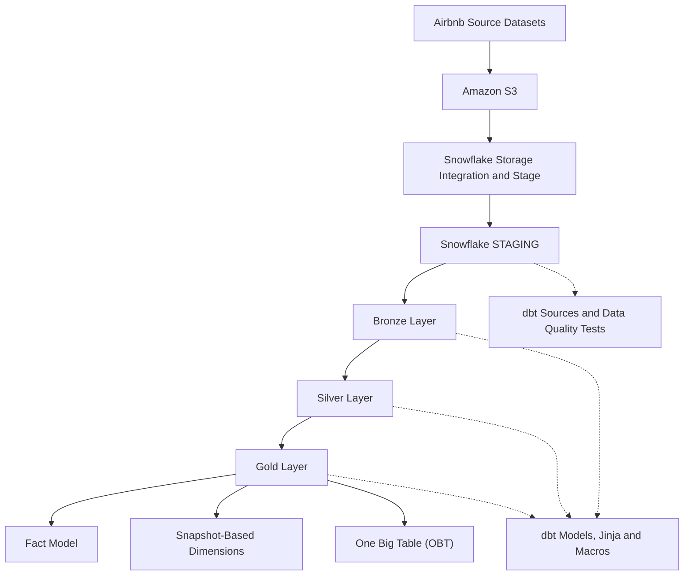
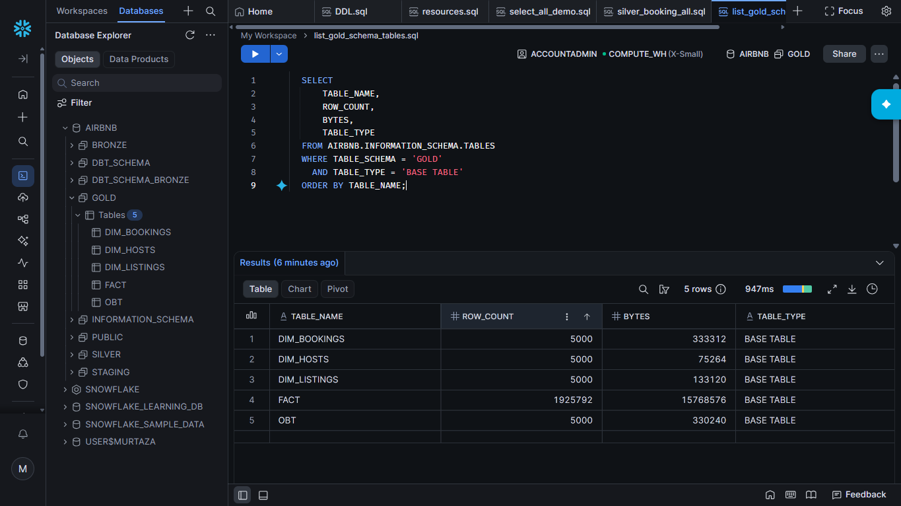
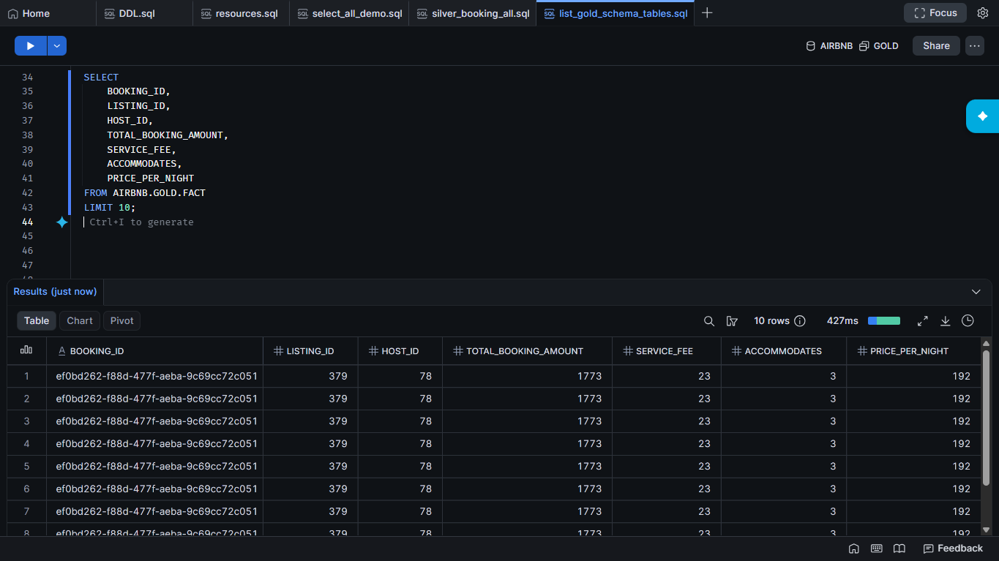
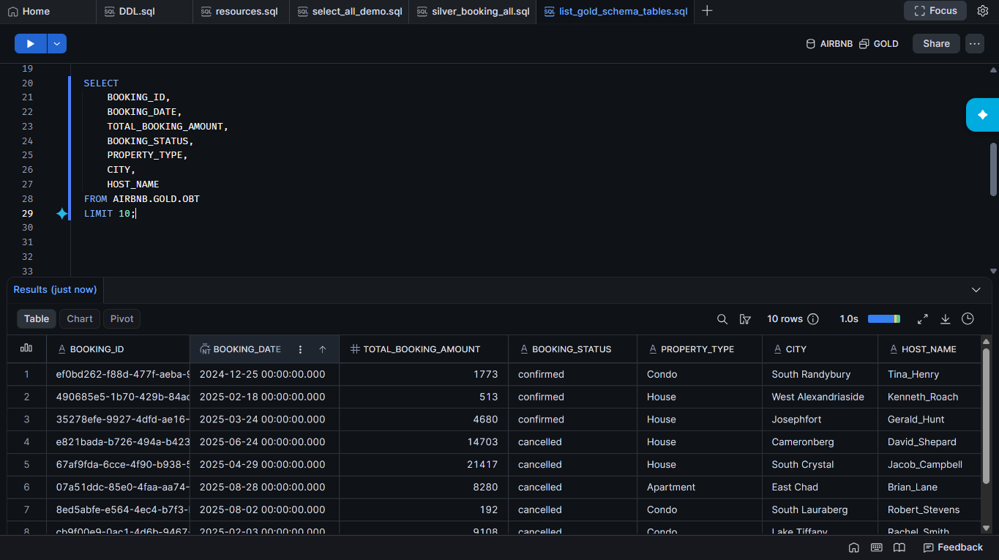
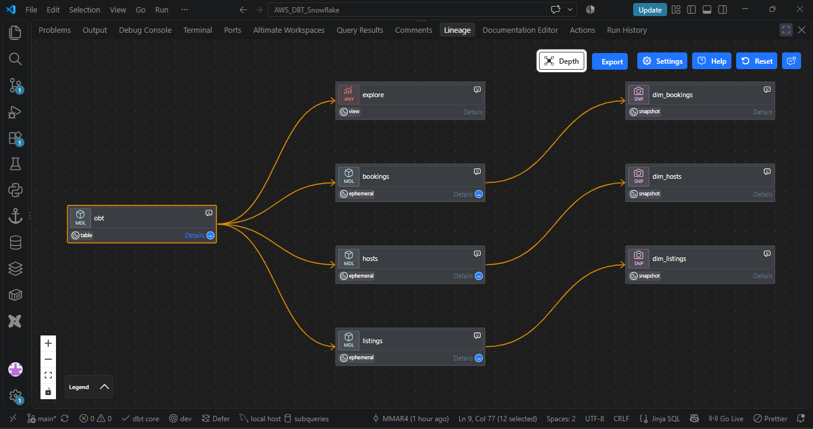
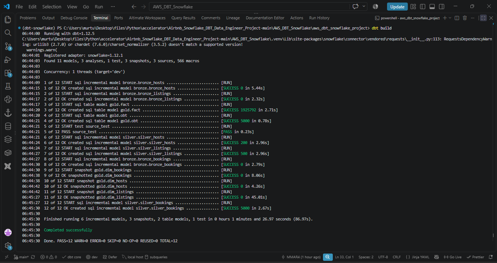

# Airbnb End-to-End Data Engineering Pipeline

An end-to-end ELT pipeline that uses **AWS S3, Snowflake, and dbt Core** to transform raw Airbnb datasets into analytics-ready data using a Medallion Architecture.

<p align="left">
  
  
  
  
  
</p>

## Overview

This project implements a cloud-based data engineering pipeline for Airbnb bookings, listings, and hosts data.

Raw datasets are stored in Amazon S3 and made available to Snowflake through the configured ingestion infrastructure. dbt transforms the data through Bronze, Silver, and Gold layers, applies reusable SQL logic, tracks historical changes, and produces analytics-ready data models.

The project demonstrates practical data engineering concepts, including:

- Medallion Architecture
- Incremental data processing
- Metadata-driven processing
- SQL transformations using dbt and Jinja
- Dimensional data modeling
- Slowly Changing Dimensions (SCD Type 2)
- Data quality testing and validation
- Fact modeling and One Big Table (OBT) design

## Architecture

The pipeline follows a layered ELT approach, with Snowflake serving as the data warehouse and dbt managing SQL transformations.



### Data Flow

1. **Data ingestion:** Store the source datasets in Amazon S3 and configure the required AWS and Snowflake resources to access them.
2. **Staging:** Make the bookings, hosts, and listings source tables available in Snowflake.
3. **Bronze transformation:** Maintain a raw or minimally transformed representation of the source data.
4. **Silver transformation:** Clean, standardize, and process data for downstream use, including incremental processing where configured.
5. **Gold modeling:** Build analytical models for reporting and data consumption.
6. **Historical tracking:** Use dbt snapshots to preserve historical versions of tracked records.
7. **Validation:** Apply dbt tests to identify data quality issues.

## Project Screenshots

The following screenshots demonstrate the pipeline's implemented data models, Snowflake query results, dbt transformation lineage, and execution output.

### 1. Gold Layer — Data Model Overview

Displays the tables available in the Snowflake Gold schema, including the Fact model, snapshot-based dimensions, and One Big Table (OBT). This provides an overview of the analytical data structures produced by the pipeline.



*The Gold layer organizes transformed data into analytical models for downstream querying and reporting.*

### 2. Fact Table — Analytical Data Model

Shows the Gold-layer Fact model, including booking identifiers, listing and host relationships, and numerical measures such as booking amounts, service fees, cleaning fees, and property attributes.



*The Fact model provides a structured foundation for analyzing booking-related measures and associated entities.*

### 3. One Big Table (OBT) — Denormalized Analytics

Displays the OBT, which combines booking details with listing, property, location, and host attributes into a single denormalized dataset.



*The OBT simplifies analytical queries by bringing related information together in one table.*

### 4. dbt Model Lineage — Transformation Dependencies

Illustrates the dbt model lineage and dependencies, showing how upstream transformations connect to downstream analytical models.



*The lineage graph helps explain model relationships and trace how transformed data flows through the project.*

### 5. dbt Build — Pipeline Execution

Shows the dbt build output captured during pipeline execution, providing evidence of the models and configured validation steps processed by dbt.



*The execution output helps verify the pipeline run and review the status of the configured dbt resources.*

## Data Transformation Layers

| Layer | Purpose |
|---|---|
| Staging | Makes source datasets available in Snowflake for dbt transformations. |
| Bronze | Retains a raw or minimally transformed representation of source data. |
| Silver | Cleans, standardizes, and transforms data for downstream use. |
| Gold | Provides business-oriented analytical models and data structures. |

The exact transformations and loading behavior depend on the configuration of the individual dbt models.

## Key Features

### 1. Medallion Architecture

Organizes transformations into Bronze, Silver, and Gold layers to separate raw data, refined data, and analytical outputs.

### 2. Incremental Data Processing

Uses dbt incremental model logic where configured to process new or changed records according to each model's loading rules, reducing the need to rebuild entire datasets on every run.

### 3. Metadata-Driven Processing

Demonstrates configurable loading logic to make data processing more adaptable to different datasets and processing requirements.

### 4. Reusable SQL with Jinja and Custom Macros

Uses dbt macros and Jinja templating to reuse SQL logic, reduce repetition, and improve maintainability.

### 5. Dimensional Data Modeling

Creates analytical data models, including a Fact model, snapshot-based dimensions, and a denormalized One Big Table.

### 6. Historical Tracking with SCD Type 2

Configures timestamp-based dbt snapshots for bookings, hosts, and listings to preserve historical versions when tracked records change.

### 7. Data Quality Testing

Defines dbt sources and includes a custom SQL test to identify potential data quality issues in the source booking records.

### 8. Modular dbt Project

Separates models, macros, snapshots, analyses, source definitions, and tests into dedicated directories. The project also supports dbt's dependency graph and documentation-generation capabilities.

## Data Modeling

### Fact Model

The Gold layer includes a Fact model containing booking identifiers, listing and host relationships, and numerical measures used for analytical queries.

### Snapshot-Based Dimensions

The snapshot configurations track historical versions of booking, host, and listing records using configured unique keys and timestamp columns.

These snapshots support historical analysis by preserving previous versions of tracked records when changes are detected.

### One Big Table (OBT)

The OBT combines related booking, listing, property, location, and host attributes into a denormalized analytical dataset.

This structure simplifies queries that require information from multiple related entities, while the Fact and dimension models support a more structured modeling approach.

## Technology Stack

| Technology | Purpose |
|---|---|
| Amazon S3 | Cloud object storage for source datasets |
| Snowflake | Cloud data warehouse and SQL execution engine |
| dbt Core | SQL transformation management and orchestration |
| dbt-snowflake | dbt adapter for Snowflake |
| SQL | Data transformation and validation |
| Jinja | Dynamic SQL and reusable macros |
| Python | Development environment and tooling |
| uv | Python package and environment management |
| Git and GitHub | Version control and project documentation |

## Project Structure

The main dbt project is located in `aws_dbt_snowflake_project/`.

```text
Airbnb-Snowflake-DBT-Data-Engineering/
│
├── aws_dbt_snowflake_project/
│   ├── models/
│   │   ├── sources/
│   │   │   └── sources.yml
│   │   ├── bronze/
│   │   ├── silver/
│   │   └── gold/
│   │       └── ephemeral/
│   │
│   ├── macros/
│   ├── snapshots/
│   ├── tests/
│   ├── analyses/
│   ├── dbt_project.yml
│   └── .gitignore
│
├── docs/
│   └── images/
│       └── all_image.png
│
├── .gitignore
├── .python-version
├── pyproject.toml
├── uv.lock
└── README.md
```

This is a high-level overview of the main project components. Refer to the repository for the complete set of model and configuration files.

## Getting Started

### Prerequisites

Before running the pipeline, ensure that you have:

- Python installed.
- `uv` installed.
- A Snowflake account with the required database, schemas, warehouse, and permissions.
- An AWS S3 bucket containing the source datasets.
- The required AWS IAM permissions, Snowflake storage integration, external stage, and staging tables.
- A configured dbt profile for Snowflake.

**Important:** The project references the following source tables:

- `AIRBNB.STAGING.BOOKINGS`
- `AIRBNB.STAGING.HOSTS`
- `AIRBNB.STAGING.LISTINGS`

You must prepare the required AWS and Snowflake infrastructure and source data before running the transformations. Cloning this repository alone does not create those resources or load the source datasets.

### 1. Clone the Repository

```bash
git clone https://github.com/MMAR4/Airbnb-Snowflake-DBT-Data-Engineering.git
cd Airbnb-Snowflake-DBT-Data-Engineering
```

### 2. Create the Python Environment

The following commands are for Windows PowerShell.

```powershell
uv venv .venv
.\.venv\Scripts\Activate.ps1
uv pip install dbt-snowflake
```

Verify the installation:

```bash
dbt --version
```

### 3. Configure the Snowflake Connection

Create the local dbt profiles directory and configuration file:

```powershell
New-Item -ItemType Directory -Force "$HOME\.dbt"
notepad "$HOME\.dbt\profiles.yml"
```

Use the following configuration as a template. Replace the placeholders with your own Snowflake connection details.

```yaml
aws_dbt_snowflake_project:
  target: dev
  outputs:
    dev:
      type: snowflake
      account: "<YOUR_SNOWFLAKE_ACCOUNT>"
      user: "<YOUR_SNOWFLAKE_USER>"
      password: "{{ env_var('DBT_ENV_SECRET_SNOWFLAKE_PASSWORD') }}"
      role: "<YOUR_SNOWFLAKE_ROLE>"
      warehouse: "<YOUR_SNOWFLAKE_WAREHOUSE>"
      database: AIRBNB
      schema: STAGING
      threads: 4
```

**Configuration notes:**

- The profile name, `aws_dbt_snowflake_project`, must match the `profile:` value in your `dbt_project.yml`.
- Confirm that your target database, schema, warehouse, role, and permissions match your Snowflake setup.
- Set the `DBT_ENV_SECRET_SNOWFLAKE_PASSWORD` environment variable before executing dbt commands.

For the current PowerShell session:

```powershell
$env:DBT_ENV_SECRET_SNOWFLAKE_PASSWORD = "YOUR_SNOWFLAKE_PASSWORD"
```

Use your actual password locally; never commit it to GitHub. For a persistent setup, configure the environment variable through your operating system's environment-variable settings.

### 4. Run the dbt Project

Navigate to the dbt project directory:

```bash
cd aws_dbt_snowflake_project
```

Check the Snowflake connection and profile configuration:

```bash
dbt debug
```

Parse the project configuration:

```bash
dbt parse
```

Run the transformation models:

```bash
dbt run
```

Execute data quality tests:

```bash
dbt test
```

Run the configured snapshots:

```bash
dbt snapshot
```

Build the selected dbt resources and their dependencies:

```bash
dbt build
```

Run these commands against a correctly configured environment. Some commands execute overlapping resources; `dbt build` can run models, tests, snapshots, and other supported resources according to the project's configuration and selection.

### 5. Generate dbt Documentation

Generate the documentation artifacts:

```bash
dbt docs generate
```

Serve the documentation locally:

```bash
dbt docs serve
```

Open the local address displayed in the terminal to explore the generated model documentation and lineage.

## Data Quality and Validation

The project uses dbt's testing capabilities to help identify data quality issues during transformation.

The custom SQL test at `aws_dbt_snowflake_project/tests/source_test.sql` flags source booking records with `BOOKING_AMOUNT` below the configured threshold. Its severity is set to `warn`, so matching records generate a warning rather than a test failure.

Validation should include:

- Confirming that the Snowflake source tables are accessible.
- Checking that models execute successfully.
- Reviewing configured dbt test results and warnings.
- Verifying that the Gold-layer models contain the expected data.
- Reviewing snapshot behavior when tracked source records change.

## Security and Configuration

- Keep Snowflake credentials and local `profiles.yml` files outside version control.
- Never commit AWS access keys, secret keys, passwords, or other sensitive information.
- Grant only the AWS and Snowflake permissions required by the pipeline.
- Use environment variables or an appropriate secrets-management mechanism for credentials.
- Exclude local configuration files and generated artifacts through `.gitignore`.
- If credentials were previously committed to Git history, rotate them; deleting a file from the latest commit does not invalidate exposed credentials.

## Potential Future Enhancements

- Add automated dbt validation through a CI workflow.
- Document repeatable AWS and Snowflake resource provisioning.
- Add a dashboard using the Gold-layer analytical models.
- Introduce scheduled orchestration for recurring pipeline execution.
- Expand automated data quality checks and model documentation.

## Author

**Murtaza Mohammed Rafiqi (MMAR4)**

- GitHub: [MMAR4](https://github.com/MMAR4)
- LinkedIn: [Murtaza Mohammed Rafiqi](https://www.linkedin.com/in/murtaza-rafiqui-96a68a31b/)

---

*This project demonstrates an end-to-end data engineering workflow involving cloud storage, warehouse ingestion, layered SQL transformations, historical data tracking, analytical modeling, and data quality validation.*
